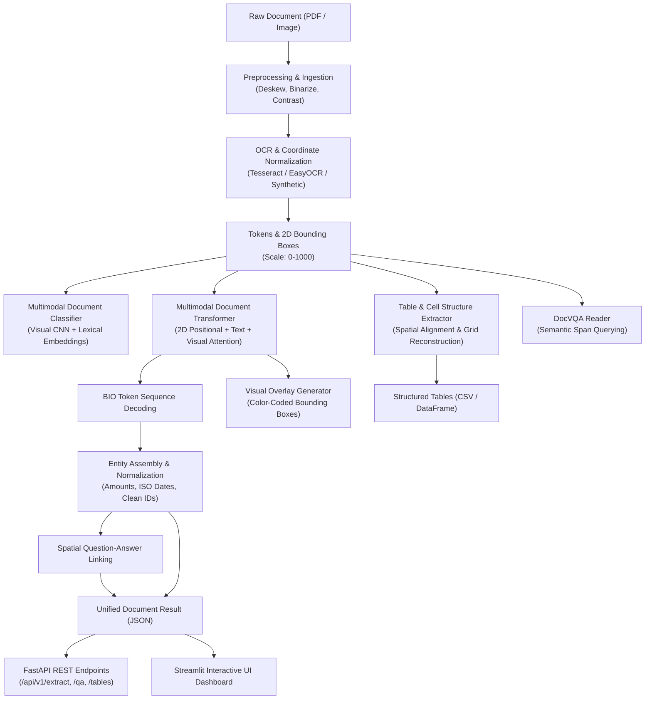

# 📄 Intelligent Document Understanding (IDU) System

[](https://github.com/codexashu/intelligent-document-understanding-system/actions/workflows/ci.yml)
[](https://www.python.org/)
[](https://pytorch.org/)
[](https://huggingface.co/)
[](https://fastapi.tiangolo.com/)
[](https://streamlit.io/)
[](https://www.docker.com/)
[](LICENSE)

An **End-to-End Deep Learning Document AI & Understanding System** for semi-structured and unstructured documents (Invoices, Receipts, Contracts, Forms, Resumes, and IDs). Combines **2D Spatial Layout Positional Embeddings**, **Computer Vision (CNN Backbones)**, and **Transformers** for state-of-the-art Document Layout Analysis, Key Information Extraction (KIE), Table Parsing, and Document Visual Question Answering (DocVQA).

---

## 🌟 Key Features

- **📑 Multi-Page PDF & Image Ingestion**: Automated PDF rasterization and document preprocessing (adaptive binarization, Hough deskewing, noise filtering, CLAHE contrast enhancement).
- **🔍 Spatial OCR Engine**: Pluggable OCR abstraction layer supporting **Tesseract OCR**, **EasyOCR**, and standalone synthetic engines with $[0, 1000]$ normalized spatial coordinate projection.
- **🧠 2D Multimodal Transformer Architecture**:
  - Implements **LayoutLMv3**-style 2D bounding box positional embeddings $(x_0, y_0, x_1, y_1, w, h)$.
  - Multimodal token classification using BIO tagging (`B-HEADER`, `B-TOTAL_AMOUNT`, `B-DATE`, `B-INVOICE_NUMBER`, `B-VENDOR_NAME`, etc.).
  - Visual ConvNet patch projection combined with lexical sequence representations.
- **🎯 Multimodal Document Classifier**: Classifies incoming documents into 8 business categories (`INVOICE`, `RECEIPT`, `FORM`, `RESUME`, `CONTRACT`, `SCIENTIFIC_REPORT`, `ID_DOCUMENT`, `OTHER`).
- **📊 Table Extraction & Cell Grid Parser**: Morphological and spatial clustering table detector that reconstructs headers, rows, and cells into structured **Pandas DataFrames** and downloadable **CSV** files.
- **💬 Document Visual Question Answering (DocVQA)**: Natural language question answering over document layouts (e.g., *"What is the invoice total?"*, *"Who is the vendor?"*).
- **🔗 Spatial Entity Linking**: Pairs questions with their respective answers using geometric reading-order distance heuristics.
- **🎨 Interactive Visual Overlay**: Renders color-coded bounding boxes and confidence score badges on top of document images.
- **⚡ Production FastAPI REST API**: High-throughput REST API with interactive Swagger docs (`/docs`).
- **🖥️ Streamlit Interactive UI**: Full-featured web dashboard for document uploads, bounding box inspection, tabular data downloads, and live DocVQA chat.
- **🐳 Containerized Deployment**: Production multi-stage `Dockerfile` and `docker-compose.yml` for unified backend and frontend orchestration.

---

## 📐 System Architecture



---

## 📂 Project Structure

```
intelligent-document-understanding-system/
├── .github/
│   └── workflows/
│       └── ci.yml                     # Automated CI/CD (lint, unit tests, docker build)
├── api/
│   ├── __init__.py
│   ├── app.py                         # FastAPI application factory
│   ├── routes.py                      # REST API route handlers
│   └── schemas.py                     # Pydantic v2 data models
├── ui/
│   ├── __init__.py
│   └── app.py                         # Streamlit interactive web dashboard
├── idu_core/
│   ├── __init__.py
│   ├── config.py                      # Global configurations, labels, device setup
│   ├── preprocessing/
│   │   ├── __init__.py
│   │   ├── image_processor.py         # Deskew, binarize, denoise, normalize
│   │   └── pdf_converter.py           # Multi-page PDF to high-res images
│   ├── ocr/
│   │   ├── __init__.py
│   │   ├── base.py                    # BoundingBox, WordToken, and BaseOCREngine
│   │   ├── tesseract_engine.py        # PyTesseract integration
│   │   ├── easyocr_engine.py          # EasyOCR deep learning backend
│   │   └── synthetic_ocr.py           # Standalone lightweight OCR engine
│   ├── models/
│   │   ├── __init__.py
│   │   ├── multimodal_transformer.py  # 2D Spatial Transformer for KIE
│   │   ├── document_classifier.py     # Multimodal Document Classifier
│   │   ├── table_extractor.py         # Table and Cell Grid Extractor
│   │   └── doc_vqa.py                 # Document Visual Question Answering Reader
│   ├── extraction/
│   │   ├── __init__.py
│   │   ├── entity_extractor.py        # BIO decoder & QA spatial linker
│   │   ├── postprocessor.py           # Date, currency, and ID normalizers
│   │   └── visualizer.py              # Visual bounding box overlay engine
│   └── pipeline.py                    # End-to-End Unified Pipeline Orchestrator
├── train/
│   ├── __init__.py
│   ├── dataset.py                     # PyTorch Dataset for document KIE
│   ├── train_classifier.py            # Document classifier training loop
│   ├── train_kie.py                   # Token classification fine-tuning loop
│   ├── synthetic_generator.py         # Synthetic document image generator
│   └── generate_mock_samples.py       # Standalone zero-dependency sample generator
├── samples/
│   ├── sample_invoice.png             # Sample commercial invoice
│   ├── sample_receipt.png             # Sample supermarket receipt
│   └── sample_medical_form.png        # Sample patient intake form
├── notebooks/
│   └── demo_walkthrough.ipynb         # Interactive step-by-step Jupyter tutorial
├── tests/
│   ├── __init__.py
│   ├── test_ocr.py                    # Unit tests for OCR & bounding box math
│   ├── test_models.py                 # Unit tests for DL models & KIE
│   ├── test_preprocessing.py          # Unit tests for image & PDF processing
│   ├── test_pipeline.py               # Unit tests for full pipeline execution
│   └── test_api.py                    # Unit tests for FastAPI endpoints
├── .dockerignore
├── .gitignore
├── Dockerfile                         # Production multi-stage Docker build
├── docker-compose.yml                 # Docker Compose for API + UI
├── pyproject.toml                     # Modern package & build metadata
├── requirements.txt                   # Production dependencies
├── requirements-dev.txt               # Development & test dependencies
├── setup.py                           # Package installation script
└── README.md                          # Enterprise documentation
```

---

## 🏷️ Supported Taxonomy

### Document Classes
`INVOICE` | `RECEIPT` | `FORM` | `RESUME` | `CONTRACT` | `SCIENTIFIC_REPORT` | `ID_DOCUMENT` | `OTHER`

### Key Information Entities (BIO Scheme)
| Entity Label | Description | Example Normalized Output |
| :--- | :--- | :--- |
| `HEADER` | Main document title / document header | `"TAX INVOICE"` |
| `QUESTION` | Key or prompt label | `"Total Amount:"` |
| `ANSWER` | Value corresponding to a prompt | `"Acme Solutions"` |
| `TOTAL_AMOUNT` | Final grand total due | `968.00` (float) |
| `DATE` | Invoice / receipt / issue date | `"2026-10-28"` (ISO-8601) |
| `INVOICE_NUMBER` | Unique transaction identifier | `"INV-2026-9041"` |
| `VENDOR_NAME` | Merchant / Seller / Issuer name | `"Apex Cloud Technologies LLC"` |
| `LINE_ITEM` | Table item description | `"AI Cloud GPU Instance"` |
| `ADDRESS` | Physical or billing street address | `"100 Innovation Way"` |

---

## 🚀 Quickstart Guide

### Option 1: Local Environment

```bash
# 1. Clone the repository
git clone https://github.com/codexashu/intelligent-document-understanding-system.git
cd intelligent-document-understanding-system

# 2. Create and activate a Python virtual environment
python3 -m venv venv
source venv/bin/activate  # On Windows: venv\Scripts\activate

# 3. Install dependencies
pip install --upgrade pip
pip install -r requirements.txt

# 4. (Optional) Install system OCR & PDF tools (macOS / Linux)
# macOS: brew install tesseract poppler
# Ubuntu: sudo apt-get install -y tesseract-ocr poppler-utils
```

### Option 2: Docker Compose (Recommended)

Run both the FastAPI backend and Streamlit UI in isolated containers:

```bash
docker-compose up --build
```

- **FastAPI REST API**: [`http://localhost:8000`](http://localhost:8000)
- **Interactive Swagger Docs**: [`http://localhost:8000/docs`](http://localhost:8000/docs)
- **Streamlit Web Dashboard**: [`http://localhost:8501`](http://localhost:8501)

---

## 💻 Running Applications

### Start the REST API

```bash
uvicorn api.app:app --host 0.0.0.0 --port 8000 --reload
```

### Start the Interactive Streamlit UI

```bash
streamlit run ui/app.py
```

---

## 📡 REST API Reference

### 1. Full Document Extraction
`POST /api/v1/extract`

Extracts OCR text, document category, key entities, tables, and linked question-answer pairs:

```bash
curl -X POST "http://localhost:8000/api/v1/extract?ocr_engine=auto" \
  -H "accept: application/json" \
  -F "file=@samples/sample_invoice.png"
```

**Sample Response:**
```json
{
  "status": "success",
  "document_type": "INVOICE",
  "type_confidence": 0.94,
  "summary": {
    "total_pages": 1,
    "total_tokens": 26,
    "total_entities": 7,
    "total_tables": 1,
    "execution_time_seconds": 0.085
  },
  "extracted_entities": {
    "INVOICE_NUMBER": [
      {
        "text": "INV-2026-8891",
        "normalized": "2026-8891",
        "confidence": 0.92,
        "box": {"x0": 210, "y0": 110, "x1": 360, "y1": 130, "width": 150, "height": 20}
      }
    ],
    "DATE": [
      {
        "text": "2026-10-28",
        "normalized": "2026-10-28",
        "confidence": 0.94,
        "box": {"x0": 110, "y0": 140, "x1": 220, "y1": 160, "width": 110, "height": 20}
      }
    ],
    "TOTAL_AMOUNT": [
      {
        "text": "$1,000.00",
        "normalized": 1000.0,
        "confidence": 0.95,
        "box": {"x0": 650, "y0": 440, "x1": 740, "y1": 465, "width": 90, "height": 25}
      }
    ]
  }
}
```

### 2. Document Classification
`POST /api/v1/classify`

```bash
curl -X POST "http://localhost:8000/api/v1/classify" \
  -F "file=@samples/sample_receipt.png"
```

### 3. Document Visual Question Answering (DocVQA)
`POST /api/v1/qa`

```bash
curl -X POST "http://localhost:8000/api/v1/qa" \
  -F "file=@samples/sample_invoice.png" \
  -F "question=What is the total amount due?"
```

**Response:**
```json
{
  "status": "success",
  "question": "What is the total amount due?",
  "answer": "$1,000.00",
  "confidence": 0.96,
  "bounding_box": {
    "x0": 650,
    "y0": 440,
    "x1": 740,
    "y1": 465,
    "width": 90,
    "height": 25
  }
}
```

### 4. Table Structure Extraction
`POST /api/v1/tables`

```bash
curl -X POST "http://localhost:8000/api/v1/tables" \
  -F "file=@samples/sample_invoice.png"
```

---

## 🧪 Running the Test Suite

Execute the comprehensive automated test suite across OCR, Deep Learning models, pipeline, and API:

```bash
python3 -m unittest discover tests -v
```

Or using `pytest`:

```bash
pytest --verbose --cov=idu_core
```

---

## 🏋️ Training & Fine-Tuning

### Train Multimodal Document Classifier
```bash
python3 train/train_classifier.py --epochs 5 --batch_size 8 --lr 1e-4
```

### Fine-Tune Multimodal Transformer (KIE)
```bash
python3 train/train_kie.py --epochs 5 --batch_size 4 --lr 3e-4
```

---

## 👨‍💻 Author

**Ashutosh Pandey**
- GitHub: [@codexashu](https://github.com/codexashu)
- Email: [pandeyashutosh082007@gmail.com](mailto:pandeyashutosh082007@gmail.com)

---

## 📄 License

This project is licensed under the MIT License - see the [LICENSE](LICENSE) file for details.
